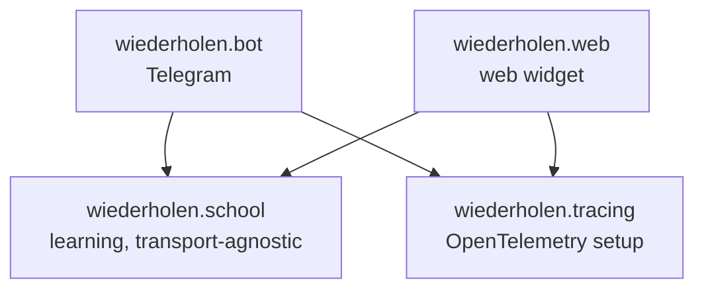
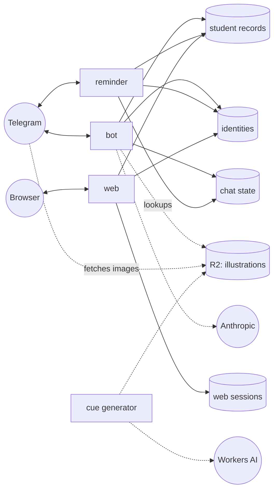

# Architecture

A map of the code: the packages, the rules between them, the processes they run as, and where each piece of state lives. Subsystems have their own pages: [Repetition schedule](repetition-schedule.md), [Storage and identity](storage.md), [Observability](tracing.md), [Telegram bot](bot.md), [AI-generated content](authoring.md) and [Web frontend](web-frontend.md). [`CLAUDE.md`](https://github.com/pauk-slon/immer-wiederholen/blob/main/CLAUDE.md) holds short rules for AI agents that point to these pages. Why significant decisions were made is recorded in [Architecture decision records](adr/README.md).

This page says *learner*; in code, a learner is a *student* (`StudentID`, `StudentRecord`).

## Packages

- **`wiederholen.school`** is everything about learning: the course, the repetition schedule, the learners' records. It knows nothing about Telegram or HTTP, so every frontend shares it.
- **`wiederholen.bot`** and **`wiederholen.web`** are two frontends to it. They depend on `school`, never the other way around, and never on each other.
- **`wiederholen.tracing`** is the OpenTelemetry setup shared by both frontends. It's a separate package so that `web` doesn't have to import it from `bot`.

### wiederholen.school

| Module | What it holds |
|---|---|
| [`curriculum`](https://github.com/pauk-slon/immer-wiederholen/blob/main/wiederholen/school/curriculum.py) | the course model — `Exercise`, `Recall`, `TopicGroup`, `Course` — and loading it from YAML (see [Course format](course-format.md)) |
| [`tutoring`](https://github.com/pauk-slon/immer-wiederholen/tree/main/wiederholen/school/tutoring) | the repetition engine: `Tutor` picks the next exercise, checks answers and decides on reminders, working on a `StudentRecord`; `SelectablePairs` chooses the word and topic; `events` reports what happened to the current trace |
| [`authoring`](https://github.com/pauk-slon/immer-wiederholen/tree/main/wiederholen/school/authoring) | content made by generative AI: `shadow_exercises` (questions rewritten by Claude) and `cues` (illustrations from Workers AI, with the generator as `cues/__main__.py`) |
| [`student_record_book`](https://github.com/pauk-slon/immer-wiederholen/blob/main/wiederholen/school/student_record_book.py) | `StudentRecordBook`, storage for learners' records, and its Redis implementation |
| [`student_identity_store`](https://github.com/pauk-slon/immer-wiederholen/blob/main/wiederholen/school/student_identity_store.py) | `StudentIdentityStore`, which maps logins (a Telegram chat, a browser) to learners |
| [`cue_store`](https://github.com/pauk-slon/immer-wiederholen/blob/main/wiederholen/school/cue_store.py) | `CueStore`, where illustrations are stored and looked up (Cloudflare R2), with an in-process cache |
| [`i18n`](https://github.com/pauk-slon/immer-wiederholen/blob/main/wiederholen/school/i18n.py) | the supported languages |

`wiederholen.school` re-exports its public API from `__init__.py`, so frontends import from `wiederholen.school` directly.

### wiederholen.bot

| Module | What it holds |
|---|---|
| [`__init__`](https://github.com/pauk-slon/immer-wiederholen/blob/main/wiederholen/bot/__init__.py) | the aiogram `dispatcher`: middlewares and routers, in an order that matters — the tracing middleware comes first, so its span also covers loading the chat state |
| [`commands/`](https://github.com/pauk-slon/immer-wiederholen/tree/main/wiederholen/bot/commands) | one module per command: `/start`, `/wiederholen` (exercises, answers, recalls), `/progress`, `/topics`, `/reminders`, `/language`, `/reset`, `/ai` |
| [`__main__`](https://github.com/pauk-slon/immer-wiederholen/blob/main/wiederholen/bot/__main__.py), [`bootstrap`](https://github.com/pauk-slon/immer-wiederholen/blob/main/wiederholen/bot/bootstrap.py) | startup: reading the configuration, building the stores, setting the bot's Telegram profile, polling |
| [`reminder`](https://github.com/pauk-slon/immer-wiederholen/blob/main/wiederholen/bot/reminder.py), [`reminder_settings`](https://github.com/pauk-slon/immer-wiederholen/blob/main/wiederholen/bot/reminder_settings.py) | the reminder process and each chat's reminder interval |
| [`chat_membership`](https://github.com/pauk-slon/immer-wiederholen/blob/main/wiederholen/bot/chat_membership.py) | noticing that a learner blocked or unblocked the bot |
| [`pending_buttons`](https://github.com/pauk-slon/immer-wiederholen/blob/main/wiederholen/bot/pending_buttons.py) | removing inline buttons from older messages once they no longer apply |
| [`topic_selection`](https://github.com/pauk-slon/immer-wiederholen/blob/main/wiederholen/bot/topic_selection.py) | narrowing the course to the topic groups a chat picked |
| [`feature_flags`](https://github.com/pauk-slon/immer-wiederholen/blob/main/wiederholen/bot/feature_flags.py) | enabling a feature for specific chats |
| [`l10n`](https://github.com/pauk-slon/immer-wiederholen/blob/main/wiederholen/bot/l10n.py) | the bot's texts in Russian and English |
| [`tracing`](https://github.com/pauk-slon/immer-wiederholen/blob/main/wiederholen/bot/tracing.py) | a span per Telegram update |

### wiederholen.web

A [Litestar](https://litestar.dev/) app with a JSON API and two static frontends: the embeddable `<german-exercise-widget>` (`static/widget.js`) and a standalone page built on it (`static/app/`). See [Web frontend](web-frontend.md).

## Rules

- **`school` doesn't know about frontends.** Nothing in it imports `bot` or `web`, deals with chat ids or HTTP, or reads environment variables — frontends pass everything in. The one exception is the cue generator's `__main__`, a command-line entry point nothing imports.
- **`tutoring` does no I/O.** `Tutor` works on a plain `dict` handed to it and never touches Redis, the network or the environment, so its tests need no mocks. Besides the standard library, it uses only pydantic (to validate records) and the OpenTelemetry API (which does nothing unless tracing is configured).
- **Frontends don't depend on each other.** Code both need goes into `school` (or, for tracing, into `wiederholen.tracing`).
- **AI calls live in `authoring`.** It's a sibling of `tutoring`, not part of it, so the scheduling engine never gains a network dependency.

## Processes and state

Dashed lines are optional integrations. The bot only checks whether an illustration exists and sends Telegram its public URL; Telegram fetches the image itself. How to run and configure each process is in [Configuration](configuration.md).

| State | Store | Shared by |
|---|---|---|
| a learner's repetition schedule and progress | `StudentRecordBook` | every frontend |
| which logins belong to which learner | `StudentIdentityStore` | every frontend |
| a Telegram chat's settings (language, topics, reminders) and the exercise being answered | aiogram's FSM storage | bot and reminder |
| the exercise shown in a web session | `WebSessionStore` | web only |

The split follows one question: would another frontend need this? A learner's progress, yes — someone who practices in Telegram and then logs in on the web should continue where they left off. A chat's language or the message with pending buttons, no.

## How an answer is handled

What happens when a learner answers an exercise in Telegram:

1. `TracingMiddleware` opens a span for the update; aiogram loads the chat's FSM state, which holds the exercise that was shown.
2. The handler resolves the chat to a learner through `StudentIdentityStore`.
3. It checks out the learner's record from `StudentRecordBook` and builds a `Tutor` on it.
4. `Tutor.check_answer()` marks the answer, reschedules the pair and schedules linked topics, recording what happened as span events.
5. The handler replies with the explanation and the next step (a recall or a "next" button).
6. It clears the chat's conversation state but keeps the chat's settings (language, `/ai` mode, selected topics) — a bare clear would reset them after every exercise.
7. When the check-out block ends, the record is saved — but only if it changed.

The web app follows the same path with three differences: an HTTP request instead of a Telegram update, traced by Litestar's OpenTelemetry plugin; a browser cookie instead of a chat id; and `WebSessionStore` instead of aiogram's FSM storage for the exercise being shown.

## Decisions

The full list is in the [ADR index](adr/README.md). Among them:

- [ADR 0002](adr/0002-tutoring-events-on-the-current-span.md): the repetition engine reports events on the current span.
- [ADR 0003](adr/0003-separate-accounts-from-logins.md): learners are separate from the ways they log in.
- [ADR 0007](adr/0007-save-records-only-when-changed.md): a student record is saved only when it changes.
- [ADR 0008](adr/0008-student-record-separate-from-chat-state.md): the student record is kept apart from chat state.
- [ADR 0009](adr/0009-one-environment-variable-per-store.md): one environment variable per store.
- [ADR 0010](adr/0010-reminders-as-a-separate-process.md): reminders run as a separate process.
