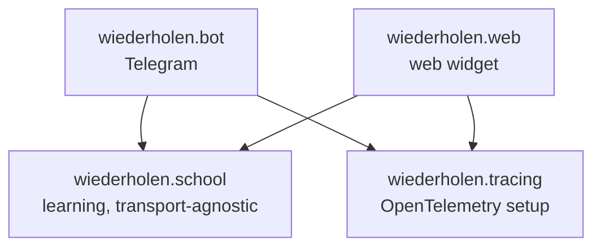
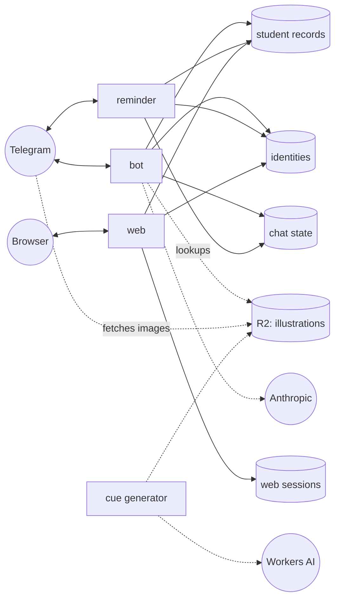

# Architecture

This page is a map of the code. It describes the packages, the rules between them, the processes that they run as, and where each piece of state is stored.

Each subsystem has its own page:

- [Repetition schedule](repetition-schedule.md)
- [Storage and identity](storage.md)
- [Observability](tracing.md)
- [Telegram bot](bot.md)
- [AI-generated content](authoring.md)
- [Web frontend](web-frontend.md)

[`CLAUDE.md`](https://github.com/pauk-slon/immer-wiederholen/blob/main/CLAUDE.md) has short rules for AI agents, with links to these pages. The [Architecture decision records](adr/README.md) explain the reasons for the main design choices.

This page uses the word *learner*. In the code, a learner is a *student* (`StudentID`, `StudentRecord`).

## Packages

- **`wiederholen.school`** contains the learning logic, such as the course, the repetition schedule and the learners' records. It knows nothing about Telegram or HTTP, so all frontends can share it.
- **`wiederholen.bot`** and **`wiederholen.web`** are the two frontends. They depend on `school`. `school` never depends on them, and they never depend on each other.
- **`wiederholen.tracing`** is the OpenTelemetry setup that both frontends share. It is a separate package, so `web` doesn't have to import it from `bot`.

### wiederholen.school

| Module | What it holds |
|---|---|
| [`curriculum`](https://github.com/pauk-slon/immer-wiederholen/blob/main/wiederholen/school/curriculum.py) | the course model (`Exercise`, `Recall`, `TopicGroup`, `Course`) and its loading from YAML (see [Course format](course-format.md)) |
| [`tutoring`](https://github.com/pauk-slon/immer-wiederholen/tree/main/wiederholen/school/tutoring) | the repetition engine. `Tutor` works on a `StudentRecord`. It picks the next exercise, checks answers and decides on reminders. `SelectablePairs` chooses the word and topic. `events` reports what happened to the current trace |
| [`authoring`](https://github.com/pauk-slon/immer-wiederholen/tree/main/wiederholen/school/authoring) | content from generative AI. `shadow_exercises` are exercises that Claude rewrites. `cues` are illustrations from Workers AI, and `cues/__main__.py` is their generator |
| [`student_record_book`](https://github.com/pauk-slon/immer-wiederholen/blob/main/wiederholen/school/student_record_book.py) | `StudentRecordBook`, the storage for learners' records, and its Redis implementation |
| [`student_identity_store`](https://github.com/pauk-slon/immer-wiederholen/blob/main/wiederholen/school/student_identity_store.py) | `StudentIdentityStore`, which maps logins (a Telegram chat, a browser) to learners |
| [`cue_store`](https://github.com/pauk-slon/immer-wiederholen/blob/main/wiederholen/school/cue_store.py) | `CueStore`, which stores and finds illustrations in Cloudflare R2, with an in-process cache |
| [`i18n`](https://github.com/pauk-slon/immer-wiederholen/blob/main/wiederholen/school/i18n.py) | the supported languages |

`wiederholen.school` re-exports its public API from `__init__.py`, so frontends import from `wiederholen.school` directly.

### wiederholen.bot

| Module | What it holds |
|---|---|
| [`__init__`](https://github.com/pauk-slon/immer-wiederholen/blob/main/wiederholen/bot/__init__.py) | the aiogram `dispatcher` with its middlewares and routers. Their order matters. The tracing middleware comes first, so its span also covers the loading of the chat state |
| [`commands/`](https://github.com/pauk-slon/immer-wiederholen/tree/main/wiederholen/bot/commands) | one module per command: `/start`, `/wiederholen` (exercises, answers, recalls), `/progress`, `/topics`, `/reminders`, `/language`, `/reset`, `/ai` |
| [`__main__`](https://github.com/pauk-slon/immer-wiederholen/blob/main/wiederholen/bot/__main__.py), [`bootstrap`](https://github.com/pauk-slon/immer-wiederholen/blob/main/wiederholen/bot/bootstrap.py) | startup. These modules read the configuration, build the stores, set the bot's Telegram profile and start polling |
| [`reminder`](https://github.com/pauk-slon/immer-wiederholen/blob/main/wiederholen/bot/reminder.py), [`reminder_settings`](https://github.com/pauk-slon/immer-wiederholen/blob/main/wiederholen/bot/reminder_settings.py) | the reminder process and the reminder interval of each chat |
| [`chat_membership`](https://github.com/pauk-slon/immer-wiederholen/blob/main/wiederholen/bot/chat_membership.py) | noticing that a learner blocked or unblocked the bot |
| [`pending_buttons`](https://github.com/pauk-slon/immer-wiederholen/blob/main/wiederholen/bot/pending_buttons.py) | removing inline buttons from older messages when they no longer apply |
| [`topic_selection`](https://github.com/pauk-slon/immer-wiederholen/blob/main/wiederholen/bot/topic_selection.py) | limiting the course to the topic groups that a chat chose |
| [`feature_flags`](https://github.com/pauk-slon/immer-wiederholen/blob/main/wiederholen/bot/feature_flags.py) | features that are enabled only for specific chats |
| [`l10n`](https://github.com/pauk-slon/immer-wiederholen/blob/main/wiederholen/bot/l10n.py) | the bot's texts in Russian and English |
| [`tracing`](https://github.com/pauk-slon/immer-wiederholen/blob/main/wiederholen/bot/tracing.py) | a span per Telegram update |

### wiederholen.web

A [Litestar](https://litestar.dev/) app with a JSON API and two static frontends. One is the embeddable `<german-exercise-widget>` (`static/widget.js`). The other is a standalone page built on the widget (`static/app/`). [Web frontend](web-frontend.md) describes both.

## Rules

- **`school` doesn't know about frontends.** No module in it imports `bot` or `web`, handles chat ids or HTTP, or reads environment variables. The frontends pass in all the data that `school` needs. The one exception is the cue generator's `__main__`. It is a command-line entry point, and no module imports it.
- **`tutoring` does no I/O.** `Tutor` works on a plain `dict` that it gets from the caller. It never uses Redis, the network or the environment, so its tests need no mocks. Besides the standard library, `tutoring` uses only pydantic (to validate records) and the OpenTelemetry API (which does nothing unless tracing is configured).
- **Frontends don't depend on each other.** Code that both frontends need goes into `school`, or into `wiederholen.tracing` for tracing.
- **AI calls stay in `authoring`.** `authoring` is a sibling of `tutoring`, not a part of it, so the repetition engine never gets a network dependency.

## Processes and state

Dashed lines are optional integrations. The bot only checks whether an illustration exists and sends its public URL to Telegram. Telegram then gets the image from R2 itself. [Configuration](configuration.md) describes how to run and configure each process.

| State | Store | Shared by |
|---|---|---|
| a learner's repetition schedule and progress | `StudentRecordBook` | all frontends |
| which logins belong to which learner | `StudentIdentityStore` | all frontends |
| a Telegram chat's settings (language, topics, reminders) and the exercise that the learner is answering | aiogram's FSM storage | bot and reminder |
| the exercise shown in a web session | `WebSessionStore` | web only |

One question decides where a piece of state goes. Would another frontend need it? A learner's progress, yes. A learner who practices in Telegram and then logs in on the web should continue from the same point. A chat's language or the message with pending buttons, no.

## How an answer is handled

When a learner answers an exercise in Telegram, these steps happen:

1. `TracingMiddleware` opens a span for the update. Then aiogram loads the chat's FSM state, which holds the exercise that the learner saw.
2. The handler resolves the chat to a learner through `StudentIdentityStore`.
3. The handler checks out the learner's record from `StudentRecordBook` and creates a `Tutor` for it.
4. `Tutor.check_answer()` marks the answer, schedules the pair again and schedules linked topics. It records what happened as span events.
5. The handler replies with the explanation and the next step, a recall or a "next" button.
6. The handler clears the chat's conversation state but keeps the chat's settings (language, `/ai` mode, selected topics). A plain clear would reset the settings after every exercise.
7. When the check-out block ends, `StudentRecordBook` saves the record, but only if it changed.

The web app follows the same steps, with three differences:

- An HTTP request takes the place of a Telegram update. Litestar's OpenTelemetry plugin traces it.
- A browser cookie takes the place of a chat id.
- `WebSessionStore` holds the exercise that the learner saw, in place of aiogram's FSM storage.

## Decisions

The [ADR index](adr/README.md) has the full list. These ADRs matter most for this page:

- [The repetition engine reports events on the current span](adr/0002-tutoring-events-on-the-current-span.md) (ADR 0002)
- [Separate learners from the ways they log in](adr/0003-separate-accounts-from-logins.md) (ADR 0003)
- [Save a student record only when it changes](adr/0007-save-records-only-when-changed.md) (ADR 0007)
- [Keep the student record separate from chat state](adr/0008-student-record-separate-from-chat-state.md) (ADR 0008)
- [One environment variable per store](adr/0009-one-environment-variable-per-store.md) (ADR 0009)
- [Reminders run as a separate process](adr/0010-reminders-as-a-separate-process.md) (ADR 0010)
