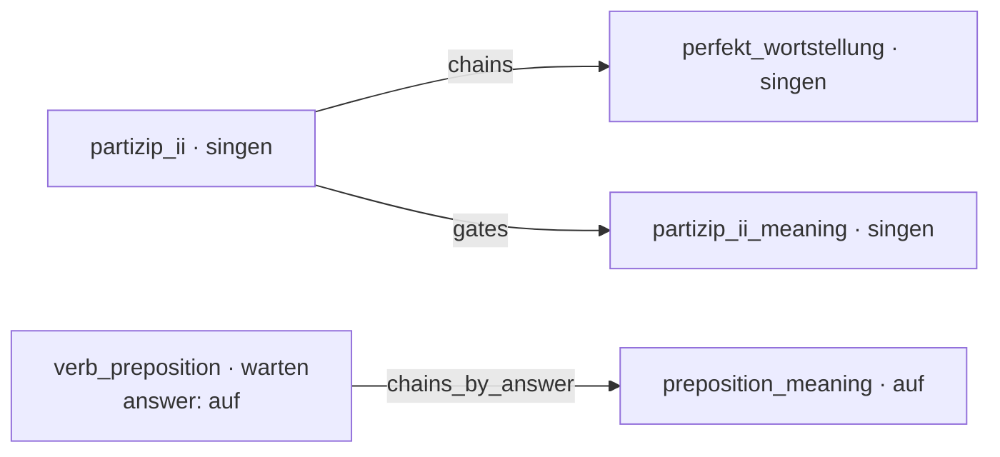

# Course format

A course is a directory of YAML files. The bot and the web app load it once at startup from the directory in the `COURSE_PATH` environment variable (default: `data`):

| File | Required | What it holds |
|---|---|---|
| `exercises.yaml` | yes | the exercises |
| `topics.yaml` | no | topic groups, links between topics, per-topic settings |
| `bot.yaml` | no | the bot's Telegram name and descriptions |

[`demo/`](https://github.com/pauk-slon/immer-wiederholen/tree/main/demo) is a small working course that uses every field and setting below; local `docker compose up` runs it by default.

Some features work only in the Telegram bot, not in the web widget; they are marked **bot only**.

## Texts in two languages

Everything shown to learners in their own language comes in Russian and English. In the tables below, `{ru, en}` means a mapping with exactly these two keys, both required:

```yaml
explanation:
  ru: warten auf + Akkusativ — ждать кого-то/что-то
  en: warten auf + Accusative — to wait for someone/something
```

## Words and topics

Every exercise drills one **word** in one **topic**:

- `word` is the vocabulary item, e.g. the verb `singen`.
- `topic` is the grammar aspect, e.g. `partizip_ii` (give the Partizip II form) or `partizip_ii_meaning` (fill it into a sentence).

Topics are free-form names; the code attaches no meaning to them, so a new topic needs only data, not a code change.

The repetition schedule is kept per **pair** of word and topic: `singen` in `partizip_ii` and `singen` in `partizip_ii_meaning` are learned and repeated independently. The links in `topics.yaml` connect such pairs, see [Linking topics](#linking-topics).

Several exercises may belong to the same pair. Each time the pair is due, one of them is picked at random, avoiding the one shown last.

## exercises.yaml

A list of exercises:

```yaml
- word: warten
  topic: verb_preposition
  question: Wir warten schon zehn Minuten ___ den Zug.
  answer: auf
  distractors: [für, an, um]
  explanation:
    ru: warten auf + Akkusativ — ждать кого-то/что-то
    en: warten auf + Accusative — to wait for someone/something
  recalls:
    - question: Wir warten ___ (der Zug).
      answer: [Wir warten auf den Zug.]
```

| Field | Required | Meaning |
|---|---|---|
| `word` | yes | the vocabulary item being drilled |
| `topic` | yes | the grammar aspect being drilled |
| `question` | yes | the text shown to the learner, e.g. a sentence with a `___` gap or a bare verb to conjugate |
| `answer` | yes | the correct answer |
| `distractors` | yes, may be `[]` | wrong options. Non-empty: the learner picks from `distractors` plus `answer`, shuffled. Empty: the learner types the answer |
| `explanation` | yes | `{ru, en}`, shown after answering, right or wrong |
| `recalls` | no | follow-up sentences to write out in full, see [Recalls](#recalls) |
| `description` | no | `{ru, en}`, shown with the question — usually a translation of the sentence, so it's clear which word is meant. Required for an illustration, see [`cue_generation`](#ai-generated-questions-and-illustrations) |
| `word_bank` | no | for word-order exercises: `answer` split into chunks, in the correct order. The bot shows them shuffled after the question, the web widget as tiles to arrange. A chunk can be several words (`im Chor`) |
| `grammar_classes` | no | **bot only.** Labels for words that behave alike in this topic, e.g. the Ablaut pattern `i-a-u` shared by `singen` and `trinken` in `partizip_ii`. See [Hints from grammar classes](#hints-from-grammar-classes) |

The answer is checked ignoring case and surrounding spaces.

### Recalls

A recall asks the learner to write out a whole sentence using the word they just answered, e.g. `Wir warten ___ (der Zug).` → `Wir warten auf den Zug.`

| Field | Required | Meaning |
|---|---|---|
| `question` | yes | the prompt |
| `answer` | yes | a list of accepted sentences |
| `hint` | no | `ru`, `en` or both, shown under the prompt, e.g. a translation of a rare word |

After a wrong answer, a recall is required before moving on. After a correct one, it's optional: the bot offers a "Drill" button ("Закрепить" in Russian). Each time, one of the exercise's recalls is picked at random; if the learner gets a recall wrong and asks for another, it's a different one where possible.

A recall answer is accepted ignoring case, extra spaces and a final `.`, `,`, `!` or `?`.

### Hints from grammar classes

**Bot only.** Once the learner has reliably learned another word with a shared grammar class in the same topic, the question gets a tap-to-reveal hint naming that word: "Same as for singen" ("Так же, как и у singen" in Russian).

Only the word is shown, not its answer: for a class like `an+Akk` (verbs taking `an` with the accusative), the other word's answer would be this one's answer too. An exercise can carry several classes, e.g. a narrow and a broad one.

### Validation

A course fails to load if:

- `answer` is one of `distractors`;
- `explanation` or `description` doesn't have exactly the `ru` and `en` keys;
- `word_bank` joined with spaces isn't `answer`;
- `grammar_classes` is an empty list (leave the field out instead);
- a recall's `answer` is empty, or its `hint` has keys other than `ru` and `en`.

## topics.yaml

Topics are organized into groups, which learners pick from with `/topics` (no selection means all groups). Groups appear in file order:

```yaml
verbs:                      # group id
  title:
    ru: Глаголы
    en: Verbs
  topics:
    partizip_ii:            # topic name, as in exercises.yaml
      chains: [perfekt_wortstellung]
      gates: [partizip_ii_meaning]
      instruction:
        ru: Укажи форму Partizip II
        en: Give the Partizip II form
    partizip_ii_meaning:
      cue_generation: true
    perfekt_wortstellung:   # a topic with no settings
```

Every topic belongs to at most one group. A topic that isn't listed anywhere can't be selected in `/topics`, so it's only shown to learners who haven't selected anything.

Each topic can have these settings, all optional:

| Setting | Meaning |
|---|---|
| `chains` | topics to schedule for today, for the same word, once this one is answered |
| `gates` | topics to keep hidden for a word until this one is answered for it |
| `chains_by_answer` | like `chains`, but for the word that is this exercise's answer |
| `instruction` | `{ru, en}`, shown under every question of this topic, e.g. "Enter the missing word" |
| `ai_generation` | **bot only.** `true` lets the `/ai` mode rewrite this topic's questions with an LLM, see below |
| `cue_generation` | **bot only.** `true` gives this topic's questions illustrations, see below |

### Linking topics

Links connect pairs of the same word, not whole topics. In the demo course:



The same links apply to `trinken` and every other word with exercises in these topics.

A link **schedules** a pair for today: it puts the pair into today's queue of new material. It does this only if the learner hasn't started that pair yet, and only if the course has an exercise for it — no `preposition_meaning` exercise for `auf`, no effect. Answering the source triggers it whether the answer was right or wrong.

- **`chains`**: answering `partizip_ii` for `singen` schedules `perfekt_wortstellung` for `singen`. Without the link it would come up anyway, just later, among other new material. Two topics may chain to each other.
- **`gates`**: `partizip_ii_meaning` for `singen` isn't shown at all until `partizip_ii` for `singen` has been answered; then it is scheduled like a chain. Use it when one topic only makes sense after another — a sentence using the form only after the form itself. A gated topic must be in the same group as the topic gating it, or selecting just its group would leave it locked forever. Two topics must not gate each other: neither would ever unlock.
- **`chains_by_answer`**: answering `verb_preposition` for `warten` (answer `auf`) schedules `preposition_meaning` for **`auf`**. Use it when the next topic is about the answer, not the word.

Chains may cross groups; gates may not. How links interact with the rest of the schedule (daily limit on new words, due reviews) is described in [Repetition schedule](repetition-schedule.md).

### AI-generated questions and illustrations

**Bot only.** Both settings are opt-in per topic and do nothing unless the deployment is set up for them, see [Configuration](configuration.md#optional-integrations). How they work is in [AI-generated content](authoring.md).

- **`ai_generation`**: in `/ai` mode, an LLM writes a new question for the same word and answer: `question`, `distractors`, `explanation`, `recalls` and `description` are generated, while `word`, `topic` and `answer` stay as authored. Enable it only for topics where the answer doesn't depend on the exact wording: not for bare-verb questions like `partizip_ii`, not for `word_bank` exercises (a new sentence wouldn't match the chunks), not where the subject decides the answer (`du brichst` vs `er bricht`).
- **`cue_generation`**: questions are shown with a **cue** — an illustration of the sentence that helps recall it. Each cue is generated from the exercise's `description.en`, so exercises without a `description` get none. Cues are generated ahead of time and stored by the hash of `question`, so editing a question's text needs a re-run of the generator to give it a picture again. Suits sentence topics with a concrete scene; pointless for pure grammar forms.

## bot.yaml

**Bot only.** The bot's Telegram profile, per language:

```yaml
info:
  ru:
    name: Immer wiederholen!
    description: Немецкая грамматика на повторе
    short_description: Немецкая грамматика на повторе
  en:
    name: Immer wiederholen!
    description: German grammar on repeat
    short_description: German grammar on repeat
```

The bot applies it to its Telegram profile on every start. Only the `ru` and `en` entries are used; any other language key is ignored. Without the file, the profile stays as it is.

## Design notes

- **`cue_generation` is a separate switch, not implied by `description`.** A description may exist just to disambiguate a sentence; adding one shouldn't turn illustrations on for a whole topic.
- **`gates` aren't derived from `chains`.** An earlier design gated every chained topic. That deadlocked topics that chain to each other (`partizip_ii` ⇄ `praeteritum`): each waited for the other to unlock. Now chains only schedule, and gating is declared explicitly.
- **`word_bank` replaced a hand-written hint in `question`.** Word-order questions used to carry the shuffled words as text, e.g. `(in Hamburg / wohnt / sie)`, kept in sync with `answer` by hand and not validated. Now the chunks are data, checked against `answer` at load time, and each frontend renders them its own way.
