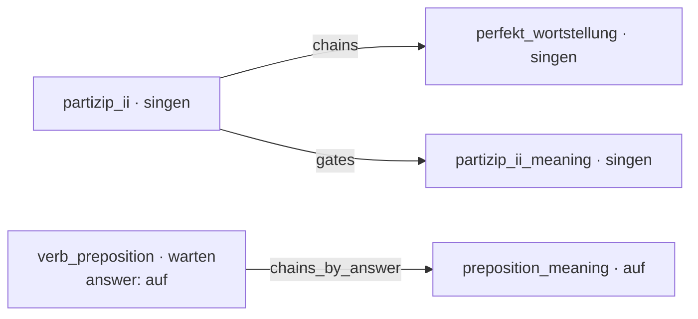

# Course format

A course is a directory of YAML files. The bot and the web app load it once at startup from the directory in the `COURSE_PATH` environment variable, which defaults to `data`.

| File | Required | What it holds |
|---|---|---|
| `exercises.yaml` | yes | the exercises |
| `topics.yaml` | no | topic groups, links between topics, per-topic settings |
| `bot.yaml` | no | the bot's Telegram name and descriptions |

[`demo/`](https://github.com/pauk-slon/immer-wiederholen/tree/main/demo) is a small working course that uses every field and setting below. Locally, `docker compose up` runs it by default.

Some features work only in the Telegram bot, not in the web widget. This page marks them **bot only**.

## Texts in two languages

Texts that learners read in their own language, such as explanations and instructions, come in Russian and English. In the tables below, `{ru, en}` means a mapping with exactly these two keys, both required:

```yaml
explanation:
  ru: warten auf + Akkusativ — ждать кого-то/что-то
  en: warten auf + Accusative — to wait for someone/something
```

## Words and topics

Each exercise practices one **word** in one **topic**:

- `word` is the vocabulary item, for example the verb `singen`.
- `topic` is the grammar aspect, for example `partizip_ii` (give the Partizip II form) or `partizip_ii_meaning` (use the form in a sentence).

Topics are free-form names. The code attaches no meaning to them, so a new topic needs only data, not a code change.

The project schedules repetitions for each **pair** of word and topic separately. For example, `singen` in `partizip_ii` and `singen` in `partizip_ii_meaning` have separate schedules. The links in `topics.yaml` connect such pairs (see [Linking topics](#linking-topics)).

Several exercises can belong to the same pair. Each time the pair is due, the bot and the web widget pick one of them at random. They avoid the exercise that the learner saw last.

## exercises.yaml

A list of exercises:

```yaml
- word: warten
  topic: verb_preposition
  question: Wir warten schon zehn Minuten ___ den Zug.
  answer: auf
  distractors: [für, an, um]
  explanation:
    ru: warten auf + Akkusativ — ждать кого-то/что-то
    en: warten auf + Accusative — to wait for someone/something
  recalls:
    - question: Wir warten ___ (der Zug).
      answer: [Wir warten auf den Zug.]
```

| Field | Required | Meaning |
|---|---|---|
| `word` | yes | the vocabulary item that the exercise practices |
| `topic` | yes | the grammar aspect that the exercise practices |
| `question` | yes | the text that the learner sees, such as a sentence with a `___` gap or a bare verb to conjugate |
| `answer` | yes | the correct answer, or a list of correct answers (see [Several correct answers](#several-correct-answers)) |
| `distractors` | yes, may be `[]` | wrong options. If there are any, the learner picks from `distractors` plus every answer, shuffled. With [`show_primary_answer_only`](#several-correct-answers), only the primary answer is an option. If the list is empty, the learner types the answer |
| `explanation` | yes | `{ru, en}`, shown after every answer, right or wrong |
| `recalls` | no | follow-up sentences that the learner types in full (see [Recalls](#recalls)) |
| `description` | no | `{ru, en}`, shown with the question. Usually it's a translation of the sentence, so it's clear which word is meant. An illustration needs it (see [`cue_generation`](#ai-generated-questions-and-illustrations)) |
| `word_bank` | no | the primary answer split into chunks, in the correct order, for word-order exercises. Other answers must use the same chunks in another order, but a capital letter can move to another chunk, as in `Ich gehe am Montag` for the chunks `Am Montag`, `gehe`, `ich`. The bot shows the chunks shuffled after the question, and the web widget shows them as tiles to arrange. If another order exists, the shuffled order isn't one of the answers. A chunk can be several words (`im Chor`) |
| `grammar_classes` | no | **bot only.** Labels for words that behave alike in this topic, such as the Ablaut pattern `i-a-u` shared by `singen` and `trinken` in `partizip_ii`. See [Hints from grammar classes](#hints-from-grammar-classes) |

The answer check ignores spaces around the answer and compares without case, by Unicode case folding. For example, `ss` also matches the German `ß`. Options can differ only in case, because case can change the meaning, like `Ihr` and `ihr` in German. An answer that is exactly one of the options counts only if it is one of the answers. An answer that matches only without case, for example one that the learner typed instead of choosing, counts only if it is an answer and no other option matches it too.

### Several correct answers

Some questions have more than one correct answer. For example, the `du` form of the Imperativ can end in `-e` or not, and `senden` has two Partizip II forms. List all of them in `answer`:

```yaml
- word: kommen
  topic: imperativ_du
  question: "Anna, (kommen) bitte schnell her!"
  answer: [Komm, Komme]
  distractors: []
```

All answers count as correct. The first answer is the **primary answer**. It is the form that the exercise teaches. After a wrong answer, the bot and the web widget show all answers, separated by ` / `. Use `explanation` to say which form is more common.

In a multiple-choice exercise, every answer is an option, so the learner sees more than one correct option. In a `word_bank` exercise, the answers are different orders of the same chunks.

Some answers are only accepted, not taught. For example, a `plural` question is `die Stadt` and the answer is `Städte`, but a learner often types `die Städte`. Put the taught form first in `answer`:

```yaml
- word: Stadt
  topic: plural
  question: die Stadt
  answer: [Städte, die Städte]
  distractors: []
```

and set `show_primary_answer_only` for the topic in `topics.yaml`:

```yaml
    plural:
      show_primary_answer_only: true
```

Then the bot and the web widget show only `Städte` after a wrong answer, and `die Städte` still counts as correct. In a multiple-choice exercise, only the primary answer is an option, so the learner never sees a correct option that the bot doesn't name. A typed answer that isn't an option still counts if it is one of the answers (see [ADR 0024](adr/0024-primary-answer-per-topic.md)).

Only the primary answer is used where the course needs one word. `chains_by_answer` schedules the topic for the primary answer, and `word_bank` gives the chunks of the primary answer in the correct order.

### Recalls

A recall asks the learner to type a whole sentence with the word they just answered. For example, `Wir warten ___ (der Zug).` becomes `Wir warten auf den Zug.`

| Field | Required | Meaning |
|---|---|---|
| `question` | yes | the prompt |
| `answer` | yes | the accepted sentence, or a list of accepted sentences |
| `hint` | no | `ru`, `en` or both, shown under the prompt, such as a translation of a rare word |

After a wrong answer, the learner must complete a recall before the next exercise. After a correct answer, the recall is optional, and the learner sees a "Drill" button ("Закрепить" in Russian). Each time, one of the exercise's recalls is picked at random. If the learner answers a recall wrong and asks for another one, a different recall is picked when possible.

The recall check ignores case, extra spaces and a final `.`, `,`, `!` or `?`. It compares by Unicode case folding too.

### Hints from grammar classes

**Bot only.** A hint appears when the learner has learned another word with the same grammar class in the same topic. The hint names that word, such as "Same as for singen" ("Так же, как и у singen" in Russian). The learner taps the hint to open it.

The hint shows only the word, not its answer, because the answers can match. For example, in a class like `an+Akk` (verbs with `an` and the accusative), the other word's answer is often the answer to this question too.

An exercise can have several classes, such as a narrow class and a broad class.

### Validation

A course fails to load if:

- `answer` is an empty list, has the same answer twice, or has an answer that is one of `distractors`
- `explanation` or `description` doesn't have exactly the `ru` and `en` keys
- `word_bank` joined with spaces isn't the primary answer, or another answer isn't an order of the `word_bank` chunks
- `grammar_classes` is an empty list (omit the field instead)
- a recall's `answer` is empty, or its `hint` has keys other than `ru` and `en`

## topics.yaml

`topics.yaml` puts topics into groups. Learners choose groups with `/topics`. If a learner chooses no group, the exercises come from all groups. The bot lists the groups in file order.

```yaml
verbs:                      # group id
  title:
    ru: Глаголы
    en: Verbs
  topics:
    partizip_ii:            # topic name, as in exercises.yaml
      chains: [perfekt_wortstellung]
      gates: [partizip_ii_meaning]
      instruction:
        ru: Укажи форму Partizip II
        en: Give the Partizip II form
    partizip_ii_meaning:
      cue_generation: true
    perfekt_wortstellung:   # a topic with no settings
```

A topic belongs to one group at most. Learners can't choose a topic that isn't in any group, so the bot shows it only to learners who chose no group.

Each topic can have these settings, all optional:

| Setting | Meaning |
|---|---|
| `chains` | topics to schedule for today, for the same word, after the learner answers this topic |
| `gates` | topics to keep hidden for a word until the learner answers this topic for that word |
| `chains_by_answer` | like `chains`, but for the word that is this exercise's primary answer |
| `instruction` | `{ru, en}`, shown under every question of this topic, such as "Enter the missing word" |
| `ai_generation` | **bot only.** `true` lets the `/ai` mode rewrite this topic's exercises with an LLM (see below) |
| `cue_generation` | **bot only.** `true` gives this topic's questions illustrations (see below) |
| `show_primary_answer_only` | `true` shows only the primary answer after a mistake and as an option. Every answer still counts (see [Several correct answers](#several-correct-answers)) |

### Linking topics

Links connect pairs of the same word, not whole topics. In the demo course:



The same links apply to `trinken` and every other word with exercises in these topics.

A link **schedules** a pair for today. This puts the pair into today's queue of new material. The link does this only if the learner hasn't started that pair yet, and only if the course has an exercise for it. For example, without a `preposition_meaning` exercise for `auf`, the link has no effect. The link works after any answer to the source pair, right or wrong.

- **`chains`**. Answering `partizip_ii` for `singen` schedules `perfekt_wortstellung` for `singen`. Without the link, the pair would still appear, but later, among other new material. Two topics may chain to each other.
- **`gates`**. The bot doesn't show `partizip_ii_meaning` for `singen` until the learner answers `partizip_ii` for `singen`. After that, the gate schedules the pair like a chain. Use a gate when one topic makes sense only after another. For example, a sentence with a Partizip II form makes sense only after the learner has practiced the form itself. Gates are not derived from chains (see [ADR 0012](adr/0012-gates-declared-explicitly.md)).
- **`chains_by_answer`**. Answering `verb_preposition` for `warten` (answer `auf`) schedules `preposition_meaning` for **`auf`**. Use it when the next topic is about the answer, not the word.

Chains can cross groups, but gates can't. A gated topic must be in the same group as the topic that gates it. Otherwise a learner who chooses only its group could never unlock it. Two topics must not gate each other, because then neither of them would ever unlock.

[Repetition schedule](repetition-schedule.md) describes how links interact with the rest of the schedule, such as the daily limit on new words and due reviews.

### AI-generated questions and illustrations

**Bot only.** You enable both settings for each topic separately. They have no effect until the deployment is configured for them (see [Configuration](configuration.md#optional-integrations)). [AI-generated content](authoring.md) describes how they work.

- **`ai_generation`**. In `/ai` mode, an LLM writes a new exercise for the same word and answer. The LLM generates `question`, `distractors`, `explanation`, `recalls` and `description`. The fields `word`, `topic` and `answer` keep their authored values. Enable the setting only for topics where the answer doesn't depend on the exact wording. This excludes bare-verb questions like `partizip_ii`, `word_bank` exercises (a new sentence wouldn't match the chunks), and topics where the subject decides the answer (`du brichst` and `er bricht`).
- **`cue_generation`**. The bot shows each question of the topic with an illustration of the sentence (a **cue** in the code). The illustration helps the learner remember the sentence. The generator makes each illustration from the exercise's `description.en`, so an exercise without a `description` gets no illustration. The generator runs ahead of time and stores each illustration by the hash of `question`. If you edit the text of a question, run the generator again to get an illustration for it. Illustrations suit sentence topics with a concrete scene. They don't help with pure grammar forms. A `description` alone doesn't turn illustrations on, because some descriptions exist only to make a sentence unambiguous (see [ADR 0014](adr/0014-cues-generated-ahead.md)).

## bot.yaml

**Bot only.** `bot.yaml` sets the bot's Telegram profile for each language.

```yaml
info:
  ru:
    name: Immer wiederholen!
    description: Немецкая грамматика на повторе
    short_description: Немецкая грамматика на повторе
  en:
    name: Immer wiederholen!
    description: German grammar on repeat
    short_description: German grammar on repeat
```

The bot applies the file to its Telegram profile on every start. It ignores language keys other than `ru` and `en`. If the file is missing, the bot doesn't change its profile.

## Decisions

- [Gates are declared explicitly](adr/0012-gates-declared-explicitly.md) (ADR 0012)
- [Word banks are data, not text in the question](adr/0013-word-bank-as-data.md) (ADR 0013)
- [Illustrations are generated ahead of time](adr/0014-cues-generated-ahead.md) (ADR 0014)
- [Illustrations are keyed by the question's hash](adr/0017-cues-keyed-by-question-hash.md) (ADR 0017)
