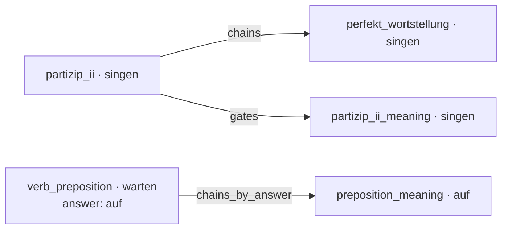

# Course format

A course is a directory of YAML files and one optional Markdown file. The bot and the web app load it once at startup from the directory in the `COURSE_PATH` environment variable, which defaults to `data`.

| File | Required | What it holds |
|---|---|---|
| `exercises.yaml` | yes | the exercises |
| `topics.yaml` | no | topic groups, links between topics, per-topic settings |
| `bot.yaml` | no | the bot's Telegram name and descriptions |
| `lesson_recall.md` | no | the guide for a lesson recall |

[`demo/`](https://github.com/pauk-slon/immer-wiederholen/tree/main/demo) is a small working course that uses every field and setting below. Locally, `docker compose up` runs it by default.

Some features work only in the Telegram bot, not in the web widget. This page marks them **bot only**.

## Texts in two languages

Texts that learners read in their own language, such as explanations and instructions, come in Russian and English. In the tables below, `{ru, en}` means a mapping with exactly these two keys, both required:

```yaml
explanation:
  ru: warten auf + Akkusativ — ждать кого-то/что-то
  en: warten auf + Accusative — to wait for someone/something
```

## Words and topics

Each exercise practices one **word** in one **topic**:

- `word` is the vocabulary item, for example the verb `singen`.
- `topic` is the grammar aspect, for example `partizip_ii` (give the Partizip II form) or `partizip_ii_meaning` (use the form in a sentence).

Topics are free-form names. The code attaches no meaning to them, so a new topic needs only data, not a code change.

The project schedules repetitions for each **pair** of word and topic separately. For example, `singen` in `partizip_ii` and `singen` in `partizip_ii_meaning` have separate schedules. The links in `topics.yaml` connect such pairs (see [Linking topics](#linking-topics)).

Several exercises can belong to the same pair. Each time the pair is due, the bot and the web widget pick one of them at random. They avoid the exercise that the learner saw last.

## exercises.yaml

A list of exercises:

```yaml
- word: warten
  topic: verb_preposition
  question: Wir warten schon zehn Minuten ___ den Zug.
  answer: auf
  distractors: [für, an, um]
  explanation:
    ru: warten auf + Akkusativ — ждать кого-то/что-то
    en: warten auf + Accusative — to wait for someone/something
  recalls:
    - question: Wir warten ___ (der Zug).
      answer: [Wir warten auf den Zug.]
```

| Field | Required | Meaning |
|---|---|---|
| `word` | yes | the vocabulary item that the exercise practices |
| `topic` | yes | the grammar aspect that the exercise practices |
| `question` | yes | the text that the learner sees, such as a sentence with a `___` gap or a bare verb to conjugate |
| `answer` | yes | the correct answer, or a list of correct answers (see [Several correct answers](#several-correct-answers)) |
| `distractors` | yes, may be `[]` | wrong options. If there are any, the learner picks from `distractors` plus every answer, shuffled. If the list is empty, the learner types the answer. With [`show_primary_answer_only`](#several-correct-answers), the primary answer is the only correct option |
| `explanation` | yes | `{ru, en}`, shown after every answer, right or wrong |
| `recalls` | no | follow-up sentences that the learner types in full (see [Recalls](#recalls)) |
| `description` | no | `{ru, en}`, shown with the question. Usually it's a translation of the sentence, so it's clear which word is meant. An illustration needs it, unless `cue` has a scene (see [`cue_generation`](#illustrations)) |
| `word_bank` | no | the primary answer split into chunks, in the correct order, for word-order exercises. Other answers must use the same chunks in another order, but a capital letter can move to another chunk, as in `Ich gehe am Montag` for the chunks `Am Montag`, `gehe`, `ich`. The bot shows the chunks shuffled after the question, and the web widget shows them as tiles to arrange. If another order exists, the shuffled order isn't one of the answers. A chunk can be several words (`im Chor`) |
| `cue` | no | **bot only.** The illustration of a topic with [`cue_generation`](#illustrations). A scene in English, such as `a woman staring in shock at a blank laptop screen`, makes the generator draw this scene instead of `description.en`. The learner never sees the text. `false` turns the illustration off for this exercise, for a sentence that no picture can show, such as a duration with `seit`. The course doesn't load if the exercise's topic has no `cue_generation` |
| `grammar_classes` | no | **bot only.** Labels for words that behave alike in this topic, such as the Ablaut pattern `i-a-u` shared by `singen` and `trinken` in `partizip_ii`. See [Hints from grammar classes](#hints-from-grammar-classes) |

The answer check ignores spaces around the answer and compares without case, by Unicode case folding. For example, `ss` also matches the German `ß`. Options can differ only in case, because case can change the meaning, like `Ihr` and `ihr` in German. An answer that is exactly one of the options counts only if it is one of the answers. An answer that matches only without case, for example one that the learner typed instead of choosing, counts only if it is an answer and no other option matches it too.

### Several correct answers

Some questions have more than one correct answer. For example, the `du` form of the Imperativ can end in `-e` or not, and `senden` has two Partizip II forms. List all of them in `answer`:

```yaml
- word: kommen
  topic: imperativ_du
  question: "Anna, (kommen) bitte schnell her!"
  answer: [Komm, Komme]
  distractors: []
```

All answers count as correct. The first answer is the **primary answer**. It is the form that the exercise teaches. After a wrong answer, the bot and the web widget show all answers, separated by ` / `, unless the topic sets `show_primary_answer_only` (see below). Use `explanation` to say which form is more common.

In a multiple-choice exercise, every answer is an option, so the learner sees more than one correct option. With `show_primary_answer_only`, the primary answer is the only correct option. In a `word_bank` exercise, the answers are different orders of the same chunks.

Some answers are only accepted, not taught. For example, a `plural` question is `die Stadt` and the answer is `Städte`, but a learner often types `die Städte`. Put the primary answer first in `answer`:

```yaml
- word: Stadt
  topic: plural
  question: die Stadt
  answer: [Städte, die Städte]
  distractors: []
```

Then set `show_primary_answer_only` for the topic in `topics.yaml`:

```yaml
nouns:
  title:
    ru: Существительные
    en: Nouns
  topics:
    plural:
      show_primary_answer_only: true
```

After a wrong answer, the bot and the web widget show only `Städte`, and `die Städte` still counts as correct. In a multiple-choice exercise, the other answers aren't options. Otherwise the learner could tap a correct option that the bot never shows as an answer. In the bot, a learner can also type an answer that isn't an option. It counts if it is one of the answers (see [ADR 0024](adr/0024-primary-answer-per-topic.md)).

Only the primary answer is used where the course needs one word. `chains_by_answer` schedules the topic for the primary answer, and `word_bank` gives the chunks of the primary answer in the correct order.

### Recalls

A recall asks the learner to type a whole sentence with the word they just answered. For example, `Wir warten ___ (der Zug).` becomes `Wir warten auf den Zug.`

| Field | Required | Meaning |
|---|---|---|
| `question` | yes | the prompt |
| `answer` | yes | the accepted sentence, or a list of accepted sentences |
| `hint` | no | `ru`, `en` or both, shown under the prompt, such as a translation of a rare word |

After a wrong answer, the learner must complete a recall before the next exercise. After a correct answer, the recall is optional, and the learner sees a "Drill" button ("Закрепить" in Russian). Each time, one of the exercise's recalls is picked at random. If the learner answers a recall wrong and asks for another one, a different recall is picked when possible. After a wrong answer to a recall, the bot and the web widget show the recall's first accepted sentence.

The recall check ignores case, extra spaces, a final `.`, `!` or `?`, and every comma. A recall tests a form or the word order, not commas. It compares by Unicode case folding too.

### Hints from grammar classes

**Bot only.** A hint appears when the learner has learned another word with the same grammar class in the same topic. The hint names that word, such as "Same as for singen" ("Так же, как у singen" in Russian). The learner taps the hint to open it.

The hint shows only the word, not its answer, because the answers can match. For example, in a class like `an+Akk` (verbs with `an` and the accusative), the other word's answer is often the answer to this question too.

An exercise can have several classes, such as a narrow class and a broad class.

### Validation

A course fails to load if:

- `answer` is an empty list, has the same answer twice, or has an answer that is one of `distractors`
- `explanation` or `description` doesn't have exactly the `ru` and `en` keys
- `word_bank` joined with spaces isn't the primary answer, or another answer isn't an order of the `word_bank` chunks
- `grammar_classes` is an empty list (omit the field instead)
- a recall's `answer` is empty, or its `hint` has keys other than `ru` and `en`

## topics.yaml

`topics.yaml` puts topics into groups. Learners choose groups with `/topics`. If a learner chooses no group, the exercises come from all groups. The bot lists the groups in file order.

```yaml
verbs:                      # group id
  title:
    ru: Глаголы
    en: Verbs
  topics:
    partizip_ii:            # topic name, as in exercises.yaml
      chains: [perfekt_wortstellung]
      gates: [partizip_ii_meaning]
      instruction:
        ru: Укажите форму Partizip II
        en: Give the Partizip II form
    partizip_ii_meaning:
      cue_generation: true
    perfekt_wortstellung:   # a topic with no settings
```

The group ids are part of the links from the landing site to the bot (see [Topic groups from a link](bot.md#topic-groups-from-a-link)). A group with a new id doesn't break a link, but the link stops selecting the group. A group id must not contain `-`, because `-` separates the groups in a link.

A topic belongs to one group at most. Learners can't choose a topic that isn't in any group, so the bot shows it only to learners who chose no group.

Each topic can have these settings, all optional:

| Setting | Meaning |
|---|---|
| `chains` | topics to schedule for today, for the same word, after the learner answers this topic |
| `gates` | topics to keep hidden for a word until the learner answers this topic for that word |
| `chains_by_answer` | like `chains`, but for the word that is this exercise's primary answer |
| `instruction` | `{ru, en}`, shown under every question of this topic, such as "Enter the missing word". The Russian text addresses the learner as "вы", as the rest of the interface does. For typed text, it says "напишите", as the recall prompt does, for example "Напишите пропущенное слово" |
| `cue_generation` | **bot only.** `true` gives this topic's questions illustrations (see below) |
| `show_primary_answer_only` | `true` shows only the primary answer after a wrong answer and makes it the only correct option. Every answer still counts as correct (see [Several correct answers](#several-correct-answers)) |

### Linking topics

Links connect pairs of the same word, not whole topics. In the demo course:



The same links apply to `trinken` and every other word with exercises in these topics.

A link **schedules** a pair for today. This puts the pair into today's queue of new material. The link does this only if the learner hasn't started that pair yet, and only if the course has an exercise for it. For example, without a `preposition_meaning` exercise for `auf`, the link has no effect. The link works after any answer to the source pair, right or wrong.

- **`chains`**. Answering `partizip_ii` for `singen` schedules `perfekt_wortstellung` for `singen`. Without the link, the pair would still appear, but later, among other new material. Two topics may chain to each other.
- **`gates`**. The bot doesn't show `partizip_ii_meaning` for `singen` until the learner answers `partizip_ii` for `singen`. After that, the gate schedules the pair like a chain. Use a gate when one topic makes sense only after another. For example, a sentence with a Partizip II form makes sense only after the learner has practiced the form itself. Gates are not derived from chains (see [ADR 0012](adr/0012-gates-declared-explicitly.md)).
- **`chains_by_answer`**. Answering `verb_preposition` for `warten` (answer `auf`) schedules `preposition_meaning` for **`auf`**. Use it when the next topic is about the answer, not the word.

Chains can cross groups, but gates can't. A gated topic must be in the same group as the topic that gates it. Otherwise a learner who chooses only its group could never unlock it. Two topics must not gate each other, because then neither of them would ever unlock.

[Repetition schedule](repetition-schedule.md) describes how links interact with the rest of the schedule, such as the daily limit on new words and due reviews.

### Illustrations

**Bot only.** You enable `cue_generation` for each topic separately. It has no effect until the deployment is configured for it (see [Configuration](configuration.md#illustrations)). [AI-generated content](authoring.md#cues) describes how it works.

The bot shows each question of the topic with an illustration of the sentence (a **cue** in the code). The illustration helps the learner remember the sentence. The generator makes each illustration from the scene in the exercise's [`cue`](#exercisesyaml), or else from `description.en`, so an exercise without either gets no illustration. `cue: false` turns the illustration off for one exercise. The generator runs ahead of time and stores each illustration by the hash of `question`, and of the scene if `cue` has one. If you edit the text of a question or its scene, run the generator again to get a new illustration. Illustrations suit sentence topics with a concrete scene. They don't help with pure grammar forms. A `description` alone doesn't turn illustrations on, because some descriptions exist only to make a sentence unambiguous (see [ADR 0014](adr/0014-cues-generated-ahead.md)).

## bot.yaml

**Bot only.** `bot.yaml` sets the bot's Telegram profile for each language.

```yaml
info:
  ru:
    name: Immer wiederholen!
    description: Немецкая грамматика на повторе
    short_description: Немецкая грамматика на повторе
  en:
    name: Immer wiederholen!
    description: German grammar on repeat
    short_description: German grammar on repeat
```

The bot applies the file to its Telegram profile on every start. It ignores language keys other than `ru` and `en`. If the file is missing, the bot doesn't change its profile.

## lesson_recall.md

**Bot only.** `lesson_recall.md` is the course's guide for a lesson recall. A lesson recall is a short task after a lesson. In the first version, the learner translates sentences from their language into the language of the course. A model writes the sentences from the exercises of the lesson and checks each translation (see [ADR 0031](adr/0031-model-writes-and-checks-a-lesson-recall.md)).

The model gets the whole file as text, so write it for the model, in English. The guide holds the method of the course:

- the language of the course, which the learner translates into
- how to write the task, such as the number of sentences and how many exercises one sentence uses
- how to write a sentence, for example whether to start from the sentence in the language of the course
- what a sentence must be: new, never a copy of an exercise sentence, natural in the learner's language, without words of the language of the course and without hints
- what each topic practices, so the model knows which form a sentence must contain
- when a translation is correct
- what the explanation of a wrong translation says, and in which form it addresses the learner

The engine adds the rest. It gives the model the exercises of the lesson, which of them the learner answered wrong, and the learner's language. It also sets the structure of the reply, and it checks only this structure. So the guide doesn't describe the reply or say which language the learner speaks. The engine has no rule about the content of a sentence. So a guide without a rule against copies can get sentences that copy the exercises.

The guide refers to the topics of the course, so it changes with them. A course without the file has no lesson recall. If the `lesson_recall` feature flag has a chat, the bot doesn't start without the file. The course fails to load if the file is empty. The demo course has a [simple guide](https://github.com/pauk-slon/immer-wiederholen/blob/main/demo/lesson_recall.md).

## Decisions

- [Gates are declared explicitly](adr/0012-gates-declared-explicitly.md) (ADR 0012)
- [Word banks are data, not text in the question](adr/0013-word-bank-as-data.md) (ADR 0013)
- [Illustrations are generated ahead of time](adr/0014-cues-generated-ahead.md) (ADR 0014)
- [Illustrations are keyed by the question's hash](adr/0017-cues-keyed-by-question-hash.md) (ADR 0017)
- [A model writes a lesson recall and checks the translations](adr/0031-model-writes-and-checks-a-lesson-recall.md) (ADR 0031)
